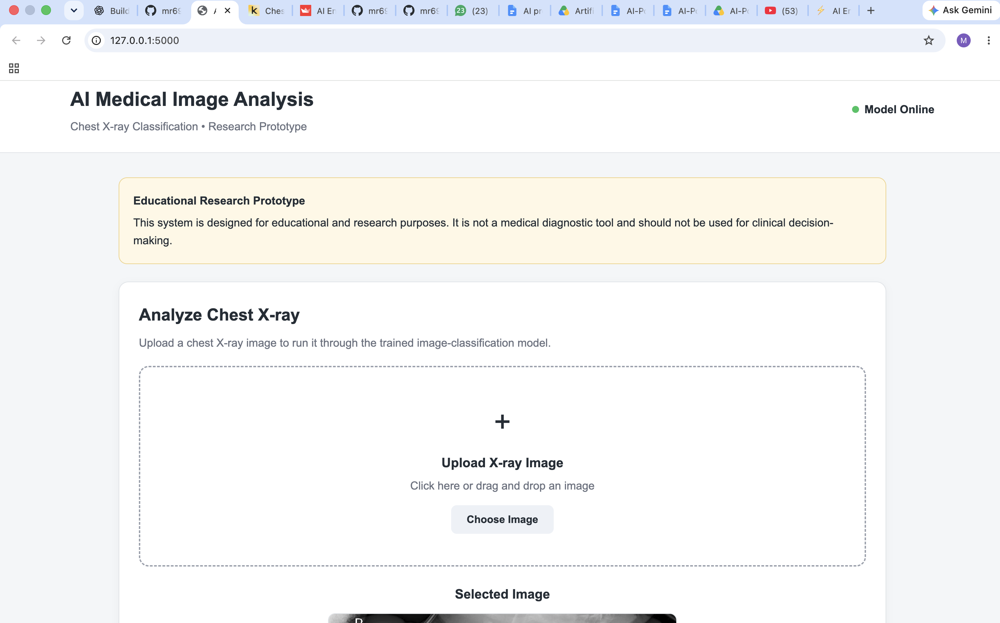
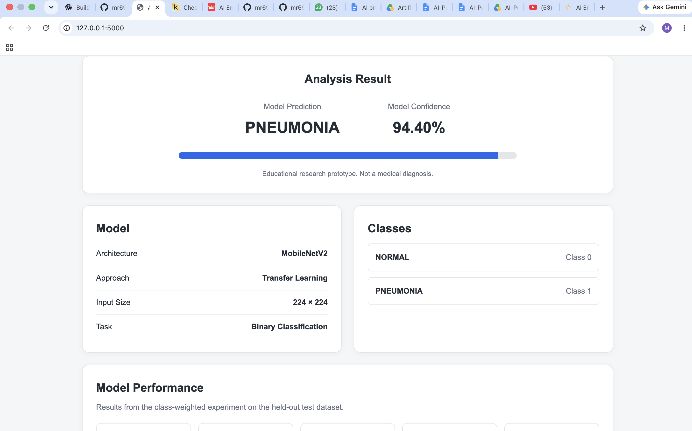
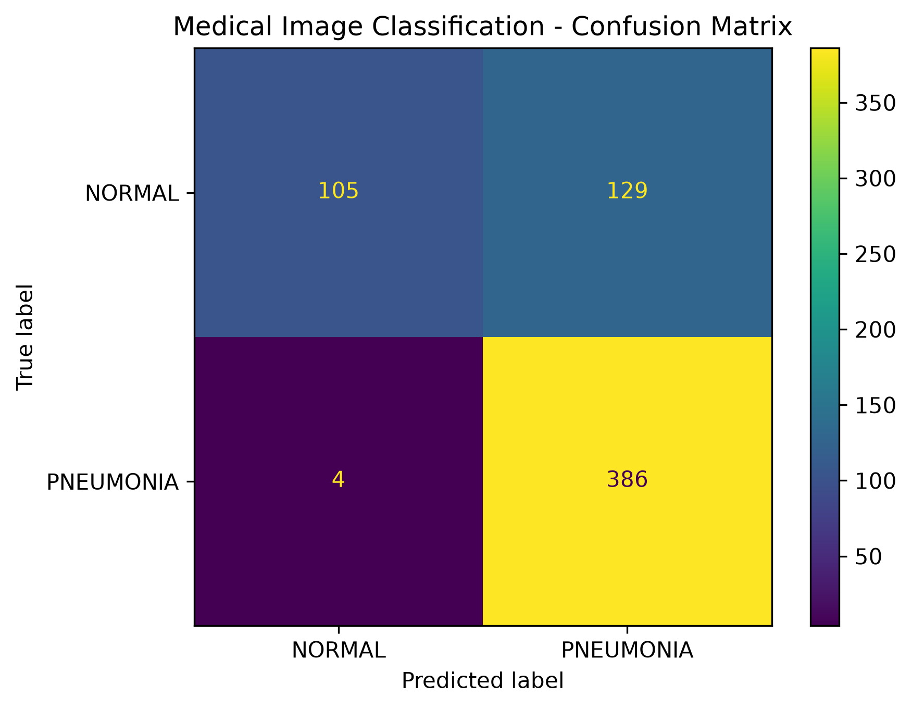

# AI Medical Image Analysis

## Chest X-ray Classification Using Transfer Learning

An educational research prototype for binary chest X-ray image classification using deep learning and transfer learning.

The project uses a pretrained **MobileNetV2** convolutional neural network and publicly available chest X-ray data to classify images into two classes:

- **NORMAL**
- **PNEUMONIA**

A Flask web application provides a simple interface for uploading an image and viewing the model's prediction and model confidence.

> **Important:** This project is an educational/research prototype. It is not a clinically validated medical diagnostic system and must not be used for clinical decision-making.

---

## Project Overview

Medical image analysis is an important application of computer vision and deep learning.

This project explores the complete machine-learning workflow:

```text
Public Dataset
      ↓
Dataset Organization
      ↓
Image Loading & Preprocessing
      ↓
Data Augmentation
      ↓
Transfer Learning
      ↓
MobileNetV2
      ↓
Model Training
      ↓
Class-Weighted Training
      ↓
Test Evaluation
      ↓
Prediction Pipeline
      ↓
Flask API
      ↓
Web Dashboard
```

The main goal is not to create a clinical diagnostic system, but to demonstrate practical skills in:

- Python
- TensorFlow/Keras
- Deep learning
- Transfer learning
- Computer vision
- Model evaluation
- Flask
- HTML/CSS/JavaScript
- Git/GitHub
- Machine-learning experimentation

---

## Features

### Machine Learning

- MobileNetV2 transfer-learning architecture
- ImageNet pretrained weights
- Binary image classification
- 224 × 224 RGB image input
- Data augmentation
- Class-weighted training
- Early stopping
- Model checkpointing

### Evaluation

- Accuracy
- Precision
- Recall
- F1-score
- Confusion matrix
- Classification report
- Comparison between baseline and class-weighted experiments

### Application

- Flask backend
- Image upload
- Drag-and-drop interface
- Image preview
- Real-time local inference
- Prediction result
- Model confidence display
- Model information
- Evaluation metrics
- Confusion matrix visualization
- Explicit research/educational disclaimer

---

## Model Architecture

The project uses **MobileNetV2** with transfer learning.

The pretrained convolutional base is used as a feature extractor, followed by:

```text
Input Image
224 × 224 × 3
       ↓
MobileNetV2
       ↓
Global Average Pooling
       ↓
Dropout
       ↓
Dense Layer
       ↓
Sigmoid Output
       ↓
NORMAL / PNEUMONIA
```

The MobileNetV2 base was initially frozen during training.

The final classification layer produces a probability for the PNEUMONIA class.

---

## Dataset

The project uses the public **Chest X-Ray Images (Pneumonia)** dataset.

The dataset is organized into:

```text
data/
└── chest_xray/
    ├── train/
    │   ├── NORMAL/
    │   └── PNEUMONIA/
    │
    ├── val/
    │   ├── NORMAL/
    │   └── PNEUMONIA/
    │
    └── test/
        ├── NORMAL/
        └── PNEUMONIA/
```

The dataset itself is intentionally **not included in this repository**.

The training split used in this experiment contained:

| Class | Images |
|---|---:|
| NORMAL | 1,341 |
| PNEUMONIA | 3,875 |
| Total | 5,216 |

The test split contained:

| Class | Images |
|---|---:|
| NORMAL | 234 |
| PNEUMONIA | 390 |
| Total | 624 |

The validation split supplied with the dataset was very small, containing 16 images. This is an important limitation of the experiment.

---

## Experiments

Two training experiments were performed.

### Experiment 1 — Baseline

The initial model was trained without class weighting.

Test accuracy:

**73.88%**

Confusion matrix:

```text
                 Predicted
              NORMAL  PNEUMONIA

Actual NORMAL     71       163
Actual PNEUMONIA   0       390
```

The baseline model strongly favored the PNEUMONIA class.

NORMAL recall was approximately:

**30%**

This indicated that many NORMAL images were incorrectly classified as PNEUMONIA.

---

### Experiment 2 — Class-Weighted Training

To address the class imbalance and improve treatment of the NORMAL class, class weights were introduced during training.

The resulting test accuracy was:

**78.69%**

Confusion matrix:

```text
                 Predicted
              NORMAL  PNEUMONIA

Actual NORMAL    105       129
Actual PNEUMONIA   4       386
```

### Performance

| Metric | Result |
|---|---:|
| Accuracy | 78.69% |
| PNEUMONIA Precision | 74.95% |
| PNEUMONIA Recall | 98.97% |
| NORMAL Recall | 44.87% |
| Weighted F1 | ~75.8% |

Compared with the baseline experiment, class weighting improved overall accuracy and substantially improved recall for the NORMAL class.

However, the model still produced a considerable number of false-positive PNEUMONIA predictions.

---

## Individual Prediction Testing

The prediction pipeline was also tested using previously unseen test-set images.

For example, one PNEUMONIA test image was correctly classified by the model.

A NORMAL test image was also tested and was incorrectly classified as PNEUMONIA.

This was intentionally retained as part of the project evidence rather than only displaying successful predictions.

This demonstrates an important machine-learning concept:

> Aggregate evaluation metrics and individual predictions can tell different stories.

---

## Web Dashboard

The project includes a local Flask dashboard.

The dashboard provides:

1. Chest X-ray image upload
2. Drag-and-drop support
3. Image preview
4. Model inference
5. Prediction display
6. Model confidence
7. Model architecture information
8. Test-set performance metrics
9. Confusion matrix
10. Project limitations

Run the application with:

```bash
python app.py
```

Then open:

```text
http://127.0.0.1:5000
```

---

---

## Dashboard Preview

The project includes a local Flask dashboard for interacting with the trained model.

### Web Dashboard



### Example Prediction

The dashboard can be used to upload a previously unseen test image and display the model's prediction and model confidence.



### Confusion Matrix

The class-weighted experiment produced the following confusion matrix on the held-out test dataset:


## API

The Flask application also exposes a prediction endpoint.

### Endpoint

```text
POST /predict
```

The request should contain an image file using the field:

```text
image
```

Example response:

```json
{
    "prediction": "PNEUMONIA",
    "model_confidence": 0.944,
    "disclaimer": "Educational research prototype. Not a medical diagnosis."
}
```

---

## Project Structure

```text
AI-Medical-Image-Analysis/
│
├── data/
│   └── chest_xray/
│
├── models/
│
├── outputs/
│   ├── metrics/
│   ├── plots/
│   └── predictions/
│
├── static/
│   ├── confusion_matrix_class_weighted.png
│   ├── script.js
│   └── style.css
│
├── templates/
│   └── index.html
│
├── src/
│   ├── __init__.py
│   ├── config.py
│   ├── data_loader.py
│   ├── evaluate.py
│   ├── model.py
│   ├── predict.py
│   └── train.py
│
├── app.py
├── main.py
├── requirements.txt
├── .gitignore
└── README.md
```

---

## Installation

### 1. Clone the repository

```bash
git clone <YOUR-GITHUB-REPOSITORY-URL>
cd AI-Medical-Image-Analysis
```

### 2. Create a virtual environment

```bash
python3.11 -m venv .venv
```

### 3. Activate it

macOS/Linux:

```bash
source .venv/bin/activate
```

### 4. Install dependencies

```bash
pip install -r requirements.txt
```

### 5. Add the dataset

Place the public chest X-ray dataset under:

```text
data/chest_xray/
```

with the expected `train`, `val`, and `test` structure.

### 6. Train the model

```bash
python -m src.train
```

### 7. Evaluate the model

```bash
python -m src.evaluate
```

### 8. Run a prediction

```bash
python -m src.predict path/to/image.jpeg
```

### 9. Start the dashboard

```bash
python app.py
```

Then open:

```text
http://127.0.0.1:5000
```

---

## Technologies

- Python
- TensorFlow
- Keras
- MobileNetV2
- NumPy
- OpenCV
- Pandas
- Matplotlib
- Scikit-learn
- Flask
- HTML
- CSS
- JavaScript
- Git
- GitHub

---

## Limitations

This project has several important limitations.

### 1. Not clinically validated

The model has not undergone clinical validation and should not be used to make medical decisions.

### 2. Dataset limitations

The experiment uses a public dataset that may not represent the diversity of real-world clinical populations, imaging equipment, acquisition protocols, or healthcare environments.

### 3. Small validation set

The supplied validation split contains only 16 images, which limits the reliability of validation-based model selection.

### 4. Class imbalance

The training dataset contains substantially more PNEUMONIA images than NORMAL images.

### 5. NORMAL-class performance

The class-weighted experiment improved NORMAL recall, but it remained substantially lower than PNEUMONIA recall.

### 6. False positives

The model incorrectly classified a considerable number of NORMAL test images as PNEUMONIA.

### 7. Confidence is not certainty

The model's confidence score represents the model's output probability after its classification process. It should not be interpreted as clinical certainty.

### 8. Limited generalization

Performance on this dataset does not establish how the model would perform on images from different hospitals, scanners, patient populations, or acquisition protocols.

---

## Future Improvements

Potential future versions could explore:

- Grad-CAM explainability
- Better validation strategies
- External validation datasets
- Probability calibration
- Threshold analysis
- More extensive hyperparameter experiments
- Cross-validation
- Model versioning
- Experiment tracking
- FastAPI deployment
- Docker
- Automated testing
- DICOM support
- Image quality checks
- More advanced medical-image architectures

These improvements would be useful for studying model reliability and explainability, but would still require appropriate validation before any clinical use.

---

## Ethical Considerations

Medical machine-learning systems require careful evaluation because incorrect predictions can have serious consequences.

For this reason, this project intentionally:

- describes itself as a research prototype
- avoids claiming clinical diagnostic capability
- reports limitations
- shows both correct and incorrect predictions
- reports class-level metrics
- includes a confusion matrix
- avoids treating model confidence as medical certainty
- keeps the public dataset outside the GitHub repository

---

## Learning Outcomes

Through this project, I practiced:

- Structuring a machine-learning project
- Loading image datasets
- Image preprocessing
- Data augmentation
- Transfer learning
- CNN-based image classification
- Handling class imbalance
- Model training
- Model evaluation
- Confusion-matrix analysis
- Precision/recall interpretation
- Building an inference pipeline
- Creating a Flask API
- Building a frontend dashboard
- Connecting frontend JavaScript to a backend API
- Managing Python environments
- Git/GitHub project organization

---

## Disclaimer

**This project is for educational and research purposes only.**

It is not a medical device, medical diagnostic system, or substitute for professional medical judgment.

Predictions produced by the model should not be used to diagnose, treat, or make decisions about any person's health.